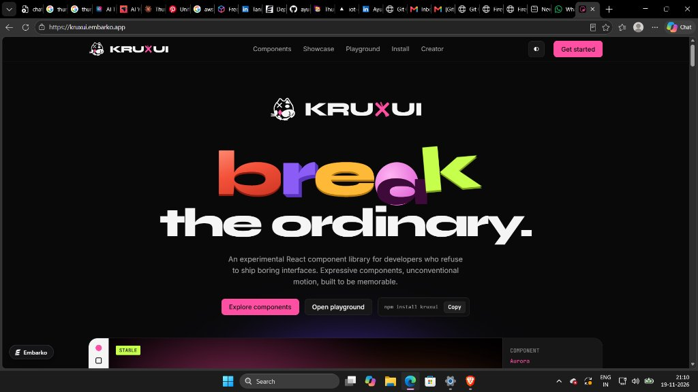
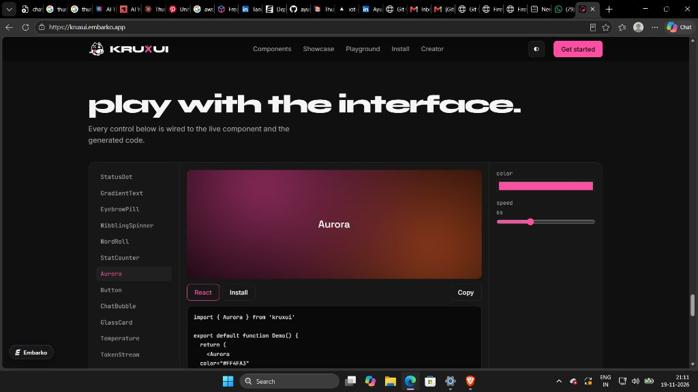
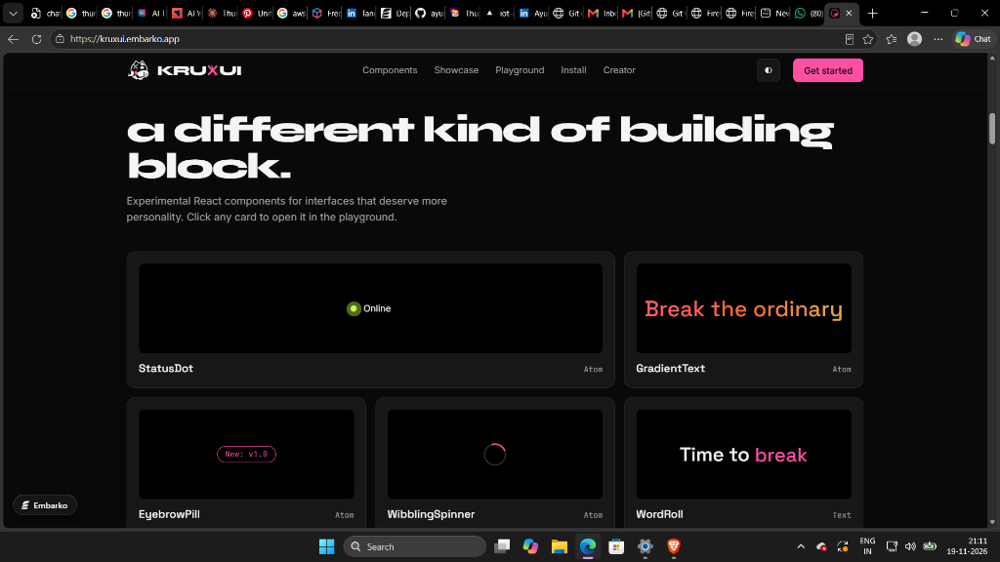
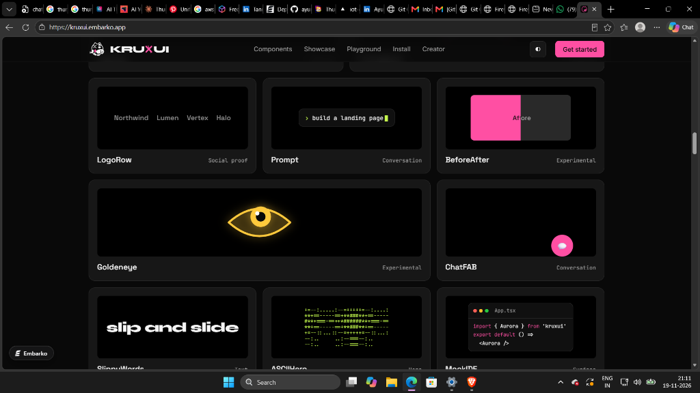

<p align="center">
  
</p>

<h1 align="center">KRUXUI — Break the ordinary.</h1>

<p align="center">
  <b>Interfaces with an edge.</b> An experimental React component library for developers who refuse to ship boring interfaces.<br/>
  Expressive motion, tactile physics, unconventional aesthetics, built to be memorable.
</p>

<p align="center">
  <a href="https://kruxui.embarko.app/"></a>
  <a href="./LICENSE"></a>
  
  
  
</p>

---

## 🌐 Live Website & Demo

Experience KRUXUI live in your browser:
👉 **[https://kruxui.embarko.app](https://kruxui.embarko.app)**

<p align="center">
  
</p>

---

## ✨ Features

- **33 Expressive Components:** From glowing fluid backgrounds (`Aurora`) to cursor-tracking pupils (`Goldeneye`), retro terminal typewriter dialogue (`QuestText`), interactive node graphs, and tactile widgets.
- **Interactive Component Playground:** Tweak live component props (colors, speeds, ranges, text labels) in real-time, instantly previewing responsive behavior and copying ready-to-use React code.
- **Full Backend API Service:** Built with Node 22, TypeScript, Hono, SQLite (`better-sqlite3`), and Zod validation.
- **Preset Saving & Sharing:** Save custom component configurations with generated 10-character shareable IDs.
- **Production Guardrails:**
  - Rate-limited writes: 10 writes per minute per IP.
  - Strict 32 KB payload size caps.
  - Parameterized SQLite queries & zero email logging.
  - CORS origin security.
  - Normalized error envelopes `{ error, status }` with no stack traces leaked.
- **Dark & Light Modes:** Built-in theme switching with accessible high-contrast palettes.

---

## 🎛️ Interactive Playground

Test props, fine-tune speeds, adjust palettes, and get clean, copyable React snippets:

<p align="center">
  
</p>

```tsx
import { Aurora } from 'kruxui'

export default function Demo() {
  return (
    <Aurora
      color="#FF4FA3"
      speed={6}
    />
  )
}
```

---

## 🧩 Component Showcase

KRUXUI features **33 unique components** designed to stand out from generic component kits:

<p align="center">
  
</p>

<p align="center">
  
</p>

### Complete Catalog (33 Components)

| Category | Components |
|---|---|
| **Atom** | `StatusDot`, `GradientText`, `EyebrowPill`, `WibblingSpinner`, `Button`, `Sparkle`, `BigBack` |
| **Text & Motion** | `WordRoll`, `TokenStream`, `SlippyWords`, `QuestText` |
| **Background** | `Aurora`, `FloatingSparkles`, `NodeGraphBackground` |
| **Surface** | `GlassCard`, `StickyBanner`, `MockIDE` |
| **Data & Meter** | `StatCounter`, `Temperature` |
| **Conversation** | `ChatBubble`, `ChatFAB`, `Prompt` |
| **Social Proof** | `LogoRow`, `CommunityBadge`, `LogoMarquee` |
| **Experimental** | `BeforeAfter`, `Goldeneye`, `Rotator` |
| **Commerce & Hero** | `PricingCard`, `ASCIIHero`, `PromptHero` |
| **Overlay & Forms** | `Popover`, `WaitlistForm` |

---

## 🛠️ Stack & Architecture

- **Backend:** [Hono](https://hono.dev/) with `@hono/node-server`
- **Database:** SQLite via `better-sqlite3` (`data.db`, automatically uses `DATA_DIR` on cloud environments)
- **Validation:** [Zod](https://zod.dev/)
- **Testing:** [Vitest](https://vitest.dev/) (15 test suites)
- **Deployment:** [Embarko](https://embarko.ai) (Serverless container deployment without Docker)

---

## 🚀 Getting Started

### 1. Clone & Install

```bash
git clone https://github.com/ayumadeit/KruxUI.git
cd KruxUI
npm install
```

### 2. Seed Database

Populates all 33 components and their exact props (idempotent):

```bash
npm run seed
```

### 3. Run Development Server

```bash
npm run dev
```

Server boots on `http://localhost:3000`.

### 4. Build & Run Production

```bash
npm run build
npm start
```

### 5. Run Test Suite

```bash
npm test
```

```text
 ✓ tests/api.test.ts (15 tests)
   ✓ GET /healthz and /api/healthz return 200 with ok status
   ✓ GET /api/components returns all 33 seeded components
   ✓ GET /api/components with category filter and search query
   ✓ GET /api/components/:slug returns single component and its props
   ✓ POST /api/presets creates a preset with valid props
   ✓ POST /api/presets rejects unknown props
   ✓ POST /api/presets rejects invalid hex color
   ✓ POST /api/presets rejects range value out of bounds
   ✓ POST /api/waitlist validates email & handles duplicates
   ✓ POST /api/feedback limits message length to 1000 chars
   ✓ Rate limit: blocks writes after 10 requests / min / IP (429)
   ✓ Body size limit: rejects payloads > 32 KB (413)

Test Files  1 passed (1)
     Tests  15 passed (15)
```

---

## 📡 API Reference (Base: `/api`)

All endpoints return JSON and format errors as `{ error: string, status: number }`.

| Method | Endpoint | Description |
|---|---|---|
| `GET` | `/healthz` | Health check endpoint |
| `GET` | `/api/components` | List components (supports `?category=` and `?q=`) |
| `GET` | `/api/components/:slug` | Retrieve component metadata + configured props |
| `POST` | `/api/presets` | Validate and store custom playground preset (`{ componentSlug, props, theme }`) |
| `GET` | `/api/presets/:id` | Fetch saved preset configuration |
| `POST` | `/api/waitlist` | Register email (idempotent `202`, never logged) |
| `POST` | `/api/feedback` | Store user feedback message (max 1,000 chars) |
| `GET` | `/` | Serves the interactive static KRUXUI showcase |

---

## ⚙️ Environment Variables

| Variable | Default | Description |
|---|---|---|
| `PORT` | `3000` | HTTP port |
| `DATA_DIR` | `./` | Directory for persistent SQLite storage |
| `DB_PATH` | `data.db` | Custom SQLite database file path |
| `ALLOWED_ORIGINS` | `*` | Comma-separated list of allowed CORS domains |
| `RESEND_API_KEY` | _none_ | If provided, marks waitlist confirmation email as sent |

---

## 👨‍💻 Creator & Community

- **Creator:** [Ayush](https://www.linkedin.com/in/ayush-linked)
- **Tagline:** *Break the ordinary. Interfaces with an edge.*
- **License:** [MIT](./LICENSE)
